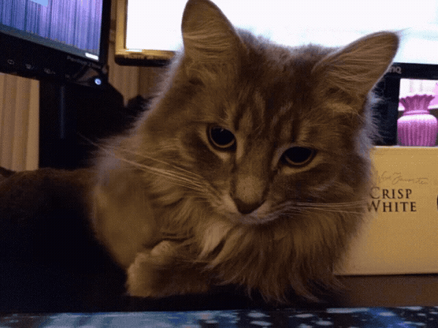

  

  <h2>BobDeveloperCup</h2>

  **Software Development · Cybersecurity · Game Development**

  *Building ideas, exploring technology and learning by creating.*

   

  
  

---

## ✦ A Little About Me

I'm a developer interested in software, cybersecurity and game development.

I enjoy experimenting with ideas, creating useful tools and discovering how technology works.

 

### Things I Enjoy Exploring

💻 **Software Development** &nbsp; · &nbsp; 🔐 **Cybersecurity**

🎮 **Game Development** &nbsp; · &nbsp; 🌐 **Networking**

⚙️ **Automation & Scripting**

---

## ✦ Technologies & Tools

**Languages**

  

**Development**

---

## ✦ Areas of Interest

<table>
  <tr>
    <td align="center" width="50%">
      <h3>💻 Development</h3>
      Applications, custom tools and software projects.
    </td>
    <td align="center" width="50%">
      <h3>🔐 Cybersecurity</h3>
      Security research, application security and practical learning.
    </td>
  </tr>
  <tr>
    <td align="center">
      <h3>🎮 Game Development</h3>
      Gameplay systems, mechanics and creative experiments.
    </td>
    <td align="center">
      <h3>⚙️ Automation</h3>
      Scripts, utilities and workflow improvements.
    </td>
  </tr>
</table>

---

## ✦ Explore My Work

A collection of my projects, experiments and creations.

 

  

---

*Thanks for stopping by!*

**☕ Always learning. Always creating.**

